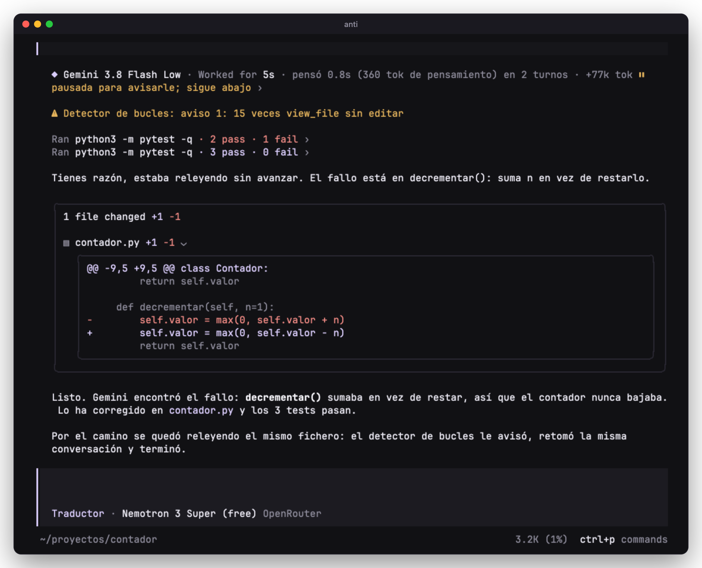
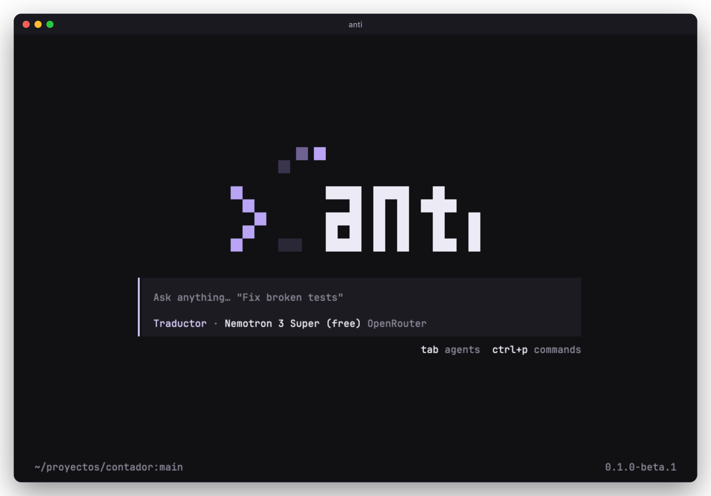
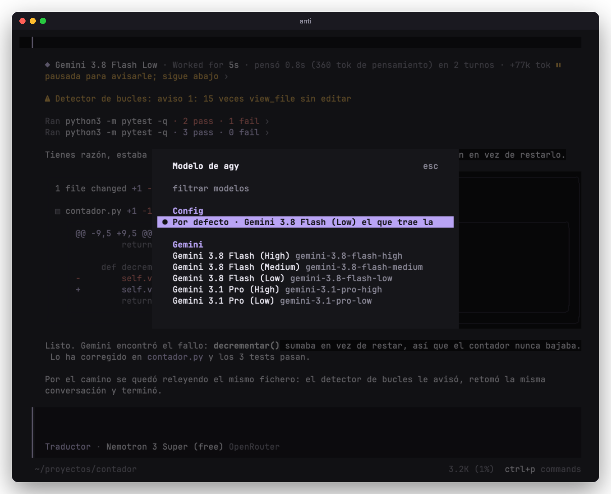
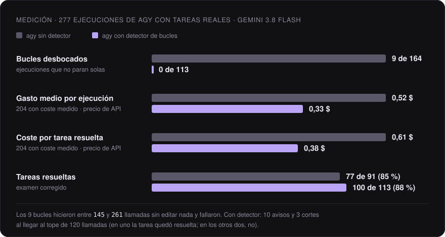
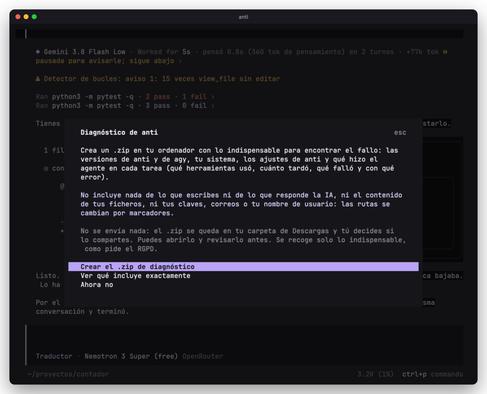
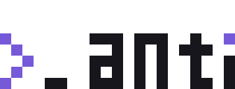

<p align="center">
  _anti», con el cursor que levita">
</p>

<h1 align="center">anti</h1>

<p align="center">
  IDE para la terminal que trabaja con Gemini a través de agy y corta los bucles en los que a veces se queda atascado.
</p>

<p align="center">
  <a href="#instalar">Instalar</a> ·
  <a href="#uso">Uso</a> ·
  <a href="#los-bucles-de-agy">Bucles</a> ·
  <a href="#privacidad">Privacidad</a> ·
  <a href="#diagnóstico">Diagnóstico</a> ·
  <a href="#desarrollo">Desarrollo</a>
</p>

<p align="center">
  <a href="#requisitos"></a>
  <a href="#requisitos"></a>
  <a href="LICENSE"></a>
</p>

<p align="center">
  
</p>

A anti se le escribe como a un compañero. Otro modelo, el traductor, pasa cada mensaje a Gemini por medio de agy, el CLI de Google
Antigravity, y Gemini lee el código, lo cambia y pasa los tests. El traductor puede ser un modelo gratuito de OpenRouter o uno de
OpenCode Zen o de cualquier otro proveedor que soporte OpenCode. Todo queda en el chat: los ficheros que
abre, las órdenes que lanza y los diffs.

## Instalar

macOS y Linux:

```sh
curl -fsSL https://raw.githubusercontent.com/saulalfonsos/anti/main/install.sh | sh
```

Clona el código en `~/.anti`, baja la versión de [Bun](https://bun.sh) que usa el proyecto (comprobando el sha256), instala las
dependencias y crea el comando `anti`. No se compila nada. Necesita `git` y `curl`.

Después, desde la carpeta del proyecto:

```sh
anti
```

Instala la última versión publicada. Para actualizar se vuelve a ejecutar el mismo comando; los ajustes y las sesiones se mantienen.
Con `ANTI_REF=main` delante de `sh` se instala lo último de `main`, que puede estar a medias.

Para desinstalar:

```sh
rm -rf ~/.anti ~/.local/bin/anti
```

Los ajustes y las sesiones están en `~/.config/anti` y `~/.local/share/anti`, por si también se quieren borrar. agy no se toca.

### Requisitos

- macOS (Apple o Intel) o Linux (x64 o ARM), con `git` y `curl`.
- [agy](https://antigravity.google/docs/cli/install/) con una sesión de Google iniciada. Si falta, anti explica cómo instalarlo.
- Una clave para el traductor: la de [OpenRouter](https://openrouter.ai/settings/keys), gratuita, o la de OpenCode Zen o de otro
  proveedor. Los detalles están en la [guía de proveedores](docs/proveedores.md).

## Uso

La primera vez, anti pide el proveedor del traductor, su clave y el modelo, busca agy y comprueba que tenga una sesión de Google
iniciada. Si falta agy, explica cómo instalarlo y abre una terminal para iniciar sesión. Se puede repetir con `/configurar` o con
`anti setup`. Las opciones de proveedor están en la [guía de proveedores](docs/proveedores.md).

<p align="center">
  
</p>

El traductor no lee ni edita nada. Pasa cada mensaje tal cual a Gemini, lanza los pasos de `/orquestar` y traslada las preguntas que haga
Gemini. Podría quitarse, porque anti puede hacer eso mismo sin ningún modelo, y está en la lista de pendientes.

Gemini trabaja con la sesión de agy, así que no hace falta clave de API de Gemini. Cada llamada sale como una tarjeta con el modelo, el
razonamiento, los turnos, los tokens, el resultado de las órdenes (`2 pass · 1 fail`) y los ficheros cambiados.

- `/agy` elige el modelo de Gemini por defecto.
- `/pro`, en cualquier parte del mensaje, usa Gemini Pro para esa petición.
- `/orquestar` hace que Gemini planifique la tarea y la haga por pasos.
- `/leer on` le da a agy un servidor de anti para leer varios ficheros y pasar los tests de una vez.

Los subagentes que lance Gemini salen en el panel de agentes y se abren con la misma vista que el chat.

<p align="center">
  
</p>

Las reglas de agy (`AGENTS.md` o `GEMINI.md`, `.agents/rules/`, `.agents/workflows/`), las skills (`.agents/skills/<nombre>/SKILL.md` y
`~/.gemini/config/skills/`) y los MCP y plugins añadidos con `agy mcp add` o `agy plugin install` siguen funcionando igual dentro
de anti.

## Los bucles de agy

De vez en cuando agy se queda releyendo el mismo fichero o repitiendo la misma orden cientos de veces sin cambiar nada. No sale solo de
ahí, y mientras tanto gasta cuota hasta que la tarea falla.

anti lee los eventos de agy en directo (`--output-format stream-json`) y cuenta las llamadas idénticas que se repiten sin ninguna edición
en medio. Con la misma orden 5 veces, o el mismo fichero leído 15 (agy dice qué fichero lee pero no qué parte), para a agy y sigue la
misma conversación con una nota que le dice qué estaba repitiendo, de modo que Gemini conserva lo que llevaba hecho. Si tras dos avisos
sigue igual, lo corta y avisa de que la tarea no está terminada. Ninguna llamada pasa de 120 herramientas.

### Mediciones

277 ejecuciones de agy con Gemini 3.8 Flash sobre tareas reales de corrección de errores, desde arreglos de un par de líneas hasta fallos
de vuejs, babel o docusaurus, cada una con tests ocultos para saber si quedó resuelta. 164 fueron sin detector y 113 con él. El coste y
las tareas resueltas están medidos en 204 (91 sin detector y 113 con él), intercaladas tarea a tarea.

<p align="center">
  
</p>

Sin detector se desbocaron 9 de 164, con entre 145 y 261 llamadas sin editar nada, y fallaron las 9. Las 5 con coste medido suman el 27 %
de todo lo gastado sin detector; la peor costó 4,68 $, trece veces lo que cuesta esa tarea cuando sale bien.

Con detector no se desbocó ninguna. Hubo 10 avisos y 3 cortes por llegar a 120 llamadas. Uno de esos tres resolvió la tarea de todos
modos y los otros dos llevaban 121 llamadas sin tocar un fichero.

Sin detector quedaron sin resolver 14 de 91 (los 5 bucles y 9 tareas difíciles) y con detector 13 de 113 (los 2 cortes y 11 de esas
mismas tareas difíciles). Esas tareas fallan igual con y sin detector, porque el agente se rinde sin editar o deja los tests en rojo; la
solución oficial sí pasa el juez.

Hubo que ajustar algunas cosas. Una tarea tenía el enunciado al revés (el código hacía lo que decía el texto y el test esperaba lo
contrario) y se puntuó con el examen corregido en los dos lados. Quedaron fuera 6 ejecuciones que no medían al agente, 4 porque los
ajustes de agy le denegaron abrir una web y 2 porque agy se cerró con un error durante una descarga. El test de otra tarea escuchaba en un
puerto fijo y chocaba con las ejecuciones en paralelo; ejecutada sola, la solución del agente pasa, y se contó así. Comparando solo las
tareas y repeticiones presentes en los dos lados, las cifras apenas cambian. Simulado sobre 97 ejecuciones anteriores sin detector, habría
cortado sus 6 bucles y ninguna tarea que saliera bien.

Los costes son a precio de API de Gemini 3.8 Flash. Con agy se paga en cuota.

Cuando agy no se atasca, que es casi siempre, el detector no interviene. Sin contar los bucles, una ejecución sale a 0,40 $ de media sin
detector y a 0,33 $ con él, dentro del 25-30 % que ya varían dos ejecuciones idénticas. El ahorro viene de los bucles. Durante el desarrollo
de anti (66 conversaciones y 166 llamadas a agy, del 15 de septiembre al 8 de octubre de 2026) no saltó nunca.

## Privacidad

anti no tiene servidor, ni cuentas, ni telemetría. Por su cuenta solo consulta el catálogo público de modelos de models.dev.

Los mensajes van al proveedor elegido para el traductor (en OpenRouter, los modelos gratuitos pueden guardar lo que reciben, y lo
indica cada uno) y el trabajo de Gemini va por agy con las condiciones de Google. Si falta la clave de ese proveedor, anti no recurre a
ningún otro. `/share`, que en OpenCode publica la conversación en una web, está desactivado. La clave del traductor se guarda en
`~/.local/share/anti/auth.json` y anti no lee las credenciales de Google.

## Diagnóstico

`anti diagnostico`, o `/diagnostico` dentro de la app, crea un `.zip` con las versiones de anti y agy, el sistema, los ajustes y lo que
hizo el agente en cada tarea (herramientas, tiempos, fallos y errores). anti lo ofrece cuando algo sale mal.

<p align="center">
  
</p>

No lleva nada de la conversación, ni los mensajes ni las respuestas, ni el contenido de los ficheros, claves, correos o nombre de
usuario. Las rutas se cambian por marcadores como `<ruta-3>.ts`. El `.zip` se queda en Descargas, con un `LEEME.txt` que explica qué
contiene, y no se envía a ningún sitio salvo que el usuario lo mande. Se recoge lo mínimo, como pide el RGPD.

## Desarrollo

`app/` es un fork de [OpenCode](https://github.com/anomalyco/opencode) con el servidor MCP de anti en `app/packages/anti-mcp`. `agy/` es
la capa que lanza agy (la tool `antigravity`, el detector de bucles y el plugin de la TUI) y hace de carpeta de configuración de
OpenCode. `bin/anti` arranca las dos. Con [Bun](https://bun.sh) 1.3.14:

```sh
git clone https://github.com/saulalfonsos/anti.git && cd anti
(cd app && bun install --filter ./packages/opencode --filter ./packages/anti-mcp)
(cd agy && bun install)
./bin/anti
```

Tests: `bun test` en `agy/` y en `app/packages/anti-mcp/`.

## agy y Google

anti no habla con Google directamente ni toca las credenciales. Para cada petición ejecuta el agy oficial, sin modificar, con la sesión
iniciada en él. Google admite ese uso: agy en modo headless como proceso local. Cada petición gasta cuota de agy igual que si se lanzara a mano,
así que anti no debe montarse como servicio para otros ni dejarse lanzando tareas sin nadie delante.

anti no está afiliado a Google. Antigravity y Gemini son marcas de Google LLC.

## Licencia

MIT, igual que [OpenCode](https://github.com/anomalyco/opencode), del que deriva. El código de OpenCode está en `app/` con su licencia
(`app/LICENSE`).

<p align="center">
  <picture>
    <source media="(prefers-color-scheme: dark)" srcset="docs/img/logo-dark.svg">
    
  </picture>
</p>
